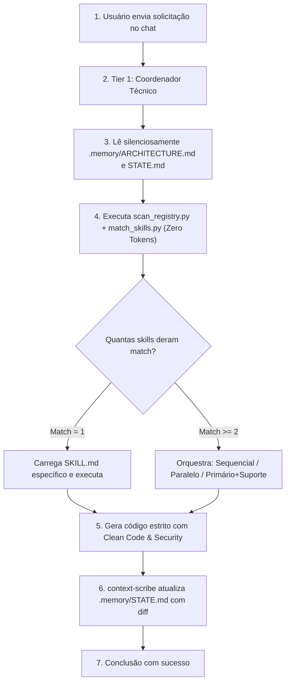

# 📘 Manual de Uso: Agent Orchestrator Ecosystem
> **Guia Definitivo e Prático para Desenvolvedores e Iniciantes:** Como usar o ecossistema com **qualquer Inteligência Artificial (LLM)** economizando até 90% dos seus tokens e eliminando alucinações.

---

## 🧭 Índice
1. [O que é e Por que Usar? (Entenda em 1 Minuto)](#1-o-que-é-e-por-que-usar-entenda-em-1-minuto)
2. [Instalação Automática em 1 Clique](#2-instalação-automática-em-1-clique)
3. [Como Inicializar em Qualquer Projeto (Memória Local)](#3-como-inicializar-em-qualquer-projeto-memória-local)
4. [Como Usar com QUALQUER LLM](#4-como-usar-com-qualquer-llm)
   - [Opção 1: Cursor IDE](#opção-1-cursor-ide)
   - [Opção 2: Claude Code (Anthropic CLI)](#opção-2-claude-code-anthropic-cli)
   - [Opção 3: Google Antigravity & Gemini CLI](#opção-3-google-antigravity--gemini-cli)
   - [Opção 4: Windsurf / Cascade (Codeium)](#opção-4-windsurf--cascade-codeium)
   - [Opção 5: VS Code com Copilot, Cline ou Roo Code](#opção-5-vs-code-com-copilot-cline-ou-roo-code)
   - [Opção 6: ChatGPT, Claude Web, Gemini Web ou Ollama](#opção-6-chatgpt-claude-web-gemini-web-ou-ollama)
5. [O Ciclo de Vida de uma Tarefa na Prática (Passo a Passo)](#5-o-ciclo-de-vida-de-uma-tarefa-na-prática-passo-a-passo)
6. [Mecanismo de Segurança e Rollback Imediato](#6-mecanismo-de-segurança-e-rollback-imediato)
7. [Como Adicionar Novas Skills](#7-como-adicionar-novas-skills)
8. [Perguntas Frequentes & Solução de Problemas (FAQ)](#8-perguntas-frequentes--solução-de-problemas-faq)
9. [Assinatura Oficial](#9-assinatura-oficial)

---

## 1. O que é e Por que Usar? (Entenda em 1 Minuto)

### O Problema do Desenvolvimento Tradicional com IA
Quando você usa assistentes de IA (Cursor, Copilot, Claude, ChatGPT), a tendência natural é criar prompts gigantes com dezenas de instruções de código limpo, arquitetura, segurança e regras de negócio.
Isso causa:
- **Estouro de Janela de Contexto:** A IA esquece o que conversou há 5 mensagens.
- **Custos Absurdos:** Enviar 5.000 tokens de regras repetidas a cada mensagem queima créditos da API.
- **Alucinações e Inconsistências:** Muita informação junta confunde o modelo, gerando código fora dos padrões.

### A Solução: Arquitetura em 2 Tiers (Coordenador + Especialistas)
Pense em uma construtora: você não tem um pedreiro que também faz o projeto elétrico, hidráulico, alvará na prefeitura e paisagismo ao mesmo tempo. Você tem um **Mestre de Obras** que chama cada **especialista** apenas quando necessário.

1. **Tier 1 - Coordenador Técnico (Prompt Mínimo):** O modelo consome menos de 400 tokens de prompt. Ele apenas lê a memória do projeto e sabe chamar scripts locais em Python.
2. **Offloading Pythonico (Custo Zero de Tokens):** A decisão pesada de descobrir quais skills usar é feita por um script Python ultra-rápido no seu computador via hash MD5 (<100ms), sem gastar 1 único token de LLM.
3. **Tier 2 - Skills e Especialistas Cirúrgicos:** Apenas a regra relevante (ex: segurança, performance ou banco de dados) é carregada pontualmente.

---

## 2. Instalação Automática em 1 Clique

Todo o ecossistema foi projetado para que **qualquer pessoa instale sem precisar configurar caminhos manuais**.

### No Windows:
1. Abra a pasta do projeto `agent-orchestrator-ecosystem`.
2. Dê **duplo clique no arquivo `install.bat`**.
3. O instalador copiará automaticamente:
   - As skills e scripts para `C:\Users\SEU_USUARIO\.agents\`
   - As instruções globais para `C:\Users\SEU_USUARIO\.gemini\`
   - A compatibilidade global para `C:\Users\SEU_USUARIO\.claude\` e `.cursorrules`
   - Um atalho do inicializador de projetos na sua Área de Trabalho.
   - Instalará o `pyyaml` e fará a indexação automática de todas as suas skills!

### No Linux ou macOS:
1. Abra o terminal na pasta do projeto e execute:
   ```bash
   chmod +x install.sh
   ./install.sh
   ```
2. O script copia os diretórios para `~/.agents`, `~/.gemini`, `~/.claude`, ajusta permissões de execução e roda o auto-discovery.

> 💡 **Requisito único:** Ter o **Python 3.10+** instalado no seu computador. No Windows, certifique-se de marcar a opção **"Add Python to PATH"** durante a instalação do Python.

---

## 3. Como Inicializar em Qualquer Projeto (Memória Local)

Quando você for iniciar um projeto novo ou conectar um projeto existente ao orquestrador, basta criar a memória local daquele repositório.

### Método 1: Via Duplo Clique (Windows)
1. Dê duplo clique no atalho **`Iniciar_Cerebro.bat`** (criado na sua Área de Trabalho ou em `%USERPROFILE%\.gemini\`).
2. Quando a janela abrir, cole o caminho da pasta do seu projeto (ou arraste a pasta para dentro do terminal) e pressione `ENTER`.

### Método 2: Via Terminal (Windows / Linux / Mac)
Abra o terminal na pasta do seu projeto e digite:
```bash
# Windows
python "%USERPROFILE%\.gemini\init_memory.py"

# Linux / macOS
python3 ~/.gemini/init_memory.py
```
*(Se você já estiver dentro da pasta do projeto, basta pressionar `ENTER` quando o script perguntar o caminho!)*

### O que é criado automaticamente no seu projeto:
```text
seu-projeto/
├── .github/workflows/
│   └── security-gate.yml         # CI/CD automatizado com Gitleaks, Semgrep e Trivy
├── .memory/
│   ├── ARCHITECTURE.md           # Lista de stack e tecnologias do projeto
│   ├── STATE.md                  # Registro da tarefa atual e ponto de rollback
│   ├── pre-deploy-security-checklist.md  # Checklist de produção (Zero-Trust)
│   └── patterns/
│       ├── engineering-rules.md  # Clean Code, SOLID, DRY, TDD
│       ├── security-rules.md     # OWASP Top 10, proteção contra IDOR, SQL Injection
│       └── performance-rules.md  # Profiling, paginação, processamento em chunks
├── CLAUDE.md                     # Regras do Coordenador para Claude Code
└── .cursorrules                  # Regras do Coordenador para Cursor IDE
```

> 🎯 **Passo Importante:** Abra o arquivo `.memory/ARCHITECTURE.md` no seu editor, marque com um `x` as tecnologias que o seu projeto usa (ex: `[x] React/Next.js`, `[x] PostgreSQL`) e apague as que não usa para economizar ainda mais tokens!

---

## 4. Como Usar com QUALQUER LLM

O grande diferencial do ecossistema é ser **100% agnóstico**. Ele não depende de uma única ferramenta proprietária.

### Opção 1: Cursor IDE
O Cursor é um dos editores com IA mais populares do mundo.
1. O instalador já gera o arquivo `.cursorrules` no seu usuário e em cada projeto inicializado.
2. *(Opcional)* Se desejar adicionar como regra global no Cursor:
   - Abra o Cursor -> Vá em **Settings (`Ctrl+,` ou `Cmd+,`)** -> **Features** -> **Rules for AI**.
   - Cole o conteúdo do arquivo `~/.gemini/GEMINI.md` no campo de regras globais.
3. **Como usar:** No chat (`Ctrl+L` ou `Ctrl+K`), basta pedir o que precisa normalmente:
   > *"Preciso criar o endpoint de autenticação com validação estrita e tokens seguros."*
4. O Cursor lerá o `.cursorrules`, executará a varredura silenciosa e chamará a skill de segurança automaticamente!

---

### Opção 2: Claude Code (Anthropic CLI)
O Claude Code é o agente oficial de terminal da Anthropic.
1. O instalador já cria o arquivo `~/.claude/CLAUDE.md` e o `CLAUDE.md` na raiz do projeto.
2. Inicie o Claude Code no terminal do seu projeto:
   ```bash
   claude
   ```
3. O Claude Code lê o arquivo `CLAUDE.md` imediatamente na inicialização.
4. Peça o que deseja:
   > *"Implemente a migration de usuários e o hash de senhas."*
5. O Claude executará o comando de match local e aplicará os padrões arquiteturais sem intervenção humana.

---

### Opção 3: Google Antigravity & Gemini CLI
1. O instalador grava as regras diretamente em `~/.gemini/GEMINI.md`.
2. O Antigravity e o Gemini CLI leem automaticamente as instruções globais.
3. Suas diretrizes de orquestração e execução de scripts locais funcionam de forma nativa.

---

### Opção 4: Windsurf / Cascade (Codeium)
1. No seu projeto, o arquivo `.windsurfrules` pode ser criado apontando para as mesmas regras.
2. Copie o conteúdo de `CLAUDE.md` ou `.cursorrules` para o arquivo `.windsurfrules`.
3. Converse com o Cascade no painel lateral normalmente.

---

### Opção 5: VS Code com Copilot, Cline ou Roo Code
Se você usa VS Code com extensões de agentes:
1. **GitHub Copilot Chat:** Abra as configurações do VS Code -> Procure por `github.copilot.chat.customInstructions` -> Aponte para o arquivo `.cursorrules` ou `CLAUDE.md`.
2. **Cline / Roo Code:** No painel da extensão, acerte as **Custom Instructions** colando o texto do `GEMINI.md`.

---

### Opção 6: ChatGPT, Claude Web, Gemini Web ou Ollama
Se você não usa um editor com agente de terminal e quer usar a IA no navegador (ChatGPT Plus, Claude.ai, Gemini Advanced) ou via Ollama local:
1. Abra uma nova conversa.
2. Cole a instrução mestre do Coordenador Técnico (encontrada no arquivo `GEMINI.md`) na sua primeira mensagem.
3. Quando você pedir uma funcionalidade (ex: *"Quero criar um scraper de notícias em Python"*), a IA vai responder com o comando para você rodar no terminal:
   ```bash
   python ~/.agents/skills/agent-orchestrator/scripts/match_skills.py "scraper de noticias em python"
   ```
4. Você roda o comando no seu terminal em 1 segundo, cola a saída JSON para a IA, e ela assume a postura do especialista com as regras perfeitas!

---

## 5. O Ciclo de Vida de uma Tarefa na Prática (Passo a Passo)

Veja exatamente o que acontece quando você pede algo:



### Exemplo Real:
1. **Seu Prompt:**
   > *"Crie a tabela de produtos e a rota de listagem paginada."*
2. **O que o Coordenador faz por baixo dos panos:**
   - Lê `.memory/ARCHITECTURE.md` para saber se seu banco é PostgreSQL, MongoDB ou SQLite.
   - Roda `match_skills.py "listar produtos paginada banco de dados"`.
   - O script retorna que há padrões de **performance** (paginação baseada em cursor) e **segurança** (prevenção de SQL Injection).
   - O Coordenador lê apenas o snippet de `.memory/patterns/performance-rules.md` e `.memory/patterns/security-rules.md`.
   - Produz o código já blindado, com tipagem e testes unitários.
   - Atualiza o `.memory/STATE.md` com a tarefa concluída e o ponto de restauração.

---

## 6. Mecanismo de Segurança e Rollback Imediato

Erros acontecem. Uma biblioteca pode mudar de versão ou a IA pode gerar uma alteração que cause quebra.
No ecossistema Agent Orchestrator, **a recuperação tem prioridade absoluta sobre a análise**.

### Como funciona:
1. Todo estado de trabalho é registrado em `.memory/STATE.md`.
2. Se uma alteração quebrar o build ou os testes:
   - A IA é orientada a **NÃO tentar adivinhar soluções por cima do código quebrado**.
   - Ela lê a tag `Último estado estável` no `STATE.md`.
   - Reverte as alterações imediatamente para o estado funcional.
   - Só depois de restabelecer a estabilidade ela replaneja a abordagem.

---

## 7. Como Adicionar Novas Skills

Você pode estender o ecossistema com quantas skills quiser:
1. Crie uma pasta dentro de `~/.agents/skills/minha-nova-skill/`.
2. Crie o arquivo `SKILL.md` com o cabeçalho YAML:
   ```markdown
   ---
   name: minha-nova-skill
   description: Descrição clara do que a skill faz e palavras-chave gatilho.
   version: 1.0.0
   ---

   # Minha Nova Skill
   Instruções operacionais detalhadas aqui...
   ```
3. O script `scan_registry.py` detectará a nova skill automaticamente na próxima solicitação através do cálculo do hash MD5.
4. Para forçar uma varredura manual e inspecionar a tabela de skills instaladas:
   ```bash
   python ~/.agents/skills/agent-orchestrator/scripts/scan_registry.py --status
   ```

---

## 8. Perguntas Frequentes & Solução de Problemas (FAQ)

### P: O terminal diz "python não é reconhecido como um comando interno ou externo".
**R:** O Python não foi adicionado às Variáveis de Ambiente do Windows.
- Baixe o instalador no site oficial [python.org](https://www.python.org/downloads/).
- Ao abrir o instalador, **marque com atenção a caixinha "Add Python to PATH"** na primeira tela e reinstale.
- Em seguida, abra um novo terminal ou rode o `install.bat` novamente.

### P: O orquestrador gasta tokens da minha conta enquanto procura as skills?
**R:** **Zero tokens.** O algoritmo de busca por capacidades, o cálculo de hashes MD5 e a verificação de arquivos são 100% executados na sua CPU local pelo script Python. Somente o resultado final consolidado é enviado ao modelo.

### P: Posso usar em projetos que não têm Git ou CI/CD?
**R:** Sim! O inicializador cria a pasta `.github/workflows/security-gate.yml` para quando você for usar o GitHub, mas o orquestrador funciona perfeitamente em pastas locais mesmo sem controle de versão ativo.

### P: Como sei quais skills estão ativas no meu sistema?
**R:** Execute no seu terminal:
```bash
python ~/.agents/skills/agent-orchestrator/scripts/scan_registry.py --status
```
Uma tabela formatada mostrará o nome de cada skill, status, linguagem e categorias detectadas.

---

## 9. Assinatura Oficial

---

Desenvolvido com 🧠 por Matheus Valpassos
[github.com/matheus-valpassos](https://github.com/matheus-valpassos)  
Mtech - Purr. Ecosystem
