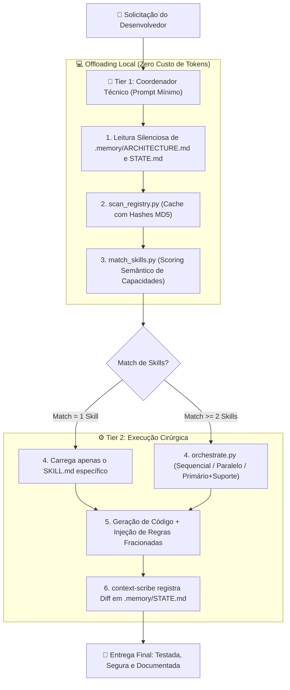

# Agent Orchestrator Ecosystem 🧠
> **O Primeiro Framework Agnóstico de Orquestração Local para Agentes de IA:** Elimine Mega-Prompts, reduza até 90% do consumo de tokens e blinde seus projetos com Clean Architecture, Zero-Trust Security e CI/CD automatizado em qualquer LLM.

[](https://python.org)
[](#)
[](#)
[](#)
[](#)

---

## 📌 O que é este projeto?

O **Agent Orchestrator Ecosystem** é uma arquitetura de desenvolvimento orientada a agentes inteligentes criada para resolver o maior gargalo atual do uso de Inteligência Artificial na engenharia de software: **o desperdício massivo de tokens e as alucinações geradas por prompts monolíticos ("Mega-Prompts")**.

Em vez de sobrecarregar cada turno de conversa com milhares de linhas de regras de codificação, segurança, performance e dezenas de ferramentas, este ecossistema estabelece uma **arquitetura de 2 Níveis (Two-Tier Architecture)** com **Offloading Pythonico Local**. 

Ele transforma qualquer assistente de IA — seja **Cursor, Claude Code, Google Antigravity, Gemini CLI, Windsurf, GitHub Copilot ou ChatGPT** — em um **Coordenador Técnico Cirúrgico de Alta Performance**.

---

## 🎯 Pra que ele serve? (Casos de Uso Reais)

O projeto serve para desenvolvedores, líderes técnicos e equipes que utilizam ferramentas de IA no dia a dia e precisam de:

1. **Economia Radical de Tokens e Custo de API:**
   Reduz o contexto inicial de milhares de tokens para **menos de 400 tokens**. A inteligência pesada de busca e roteamento é transferida para scripts Python locais executados no seu computador em milissegundos a **custo zero de tokens**.

2. **Eliminação de Alucinações e Esquecimentos:**
   Modelos de linguagem sofrem degradação de atenção quando a janela de contexto fica saturada. O orquestrador injeta apenas o snippet exato de código ou regra arquitetural necessária para a tarefa daquele momento.

3. **Governança e Blindagem Arquitetural (Sem Esforço Humano):**
   Garante que todo código gerado pela IA obedeça aos princípios de **Clean Architecture**, **SOLID**, **OWASP Top 10**, **Prevenção de IDOR/SQL Injection**, validação estrita de esquemas e testes unitários (TDD).

4. **CI/CD Security Gate Automático:**
   Injeta em cada repositório um pipeline do GitHub Actions pré-configurado com varredura de segredos (**Gitleaks**), análise estática de segurança (**Semgrep**) e auditoria de vulnerabilidades em contêineres e pacotes (**Trivy**, **npm audit**, **pip-audit**).

5. **Recuperação e Rollback Instantâneo:**
   Registra continuamente o estado da aplicação e pontos de restauração (`Rollback Points`) em `.memory/STATE.md`. Se qualquer geração quebrar o projeto, o sistema reverte as mudanças antes de tentar debugar.

---

## ⚖️ Comparativo: Desenvolvimento Comum vs. Agent Orchestrator

| Desafio | Desenvolvimento Tradicional com IA | Com Agent Orchestrator Ecosystem |
|---|---|---|
| **Tamanho do Prompt Inicial** | 3.000 a 8.000 tokens repetidos a cada turno | **Menos de 400 tokens** (Coordenador Lean) |
| **Descoberta de Ferramentas** | A IA lê descrições de dezenas de ferramentas | **Auto-Discovery Python local com hash MD5** (<100ms) |
| **Custo de Tokens** | Cresce exponencialmente conforme o chat avança | **Redução de até 90%** em gastos com tokens |
| **Padrões de Segurança** | O desenvolvedor precisa lembrar a IA de validar inputs | **Regras Zero-Trust e CI/CD injetados na memória local** |
| **Quando o Código Quebra** | A IA alucina tentando consertar sobre o erro | **Rollback Imediato** para o último estado estável |
| **Compatibilidade** | Preso a extensões ou editores proprietários | **Universal:** Funciona com qualquer LLM ou IDE |

---

## 🏗️ Como Funciona a Arquitetura?

O ecossistema divide o ciclo de desenvolvimento em duas camadas bem delimitadas:



### 1. Tier 1: Coordenador Técnico (Tier 1 Coordinator)
Atua como o maestro do projeto. O modelo não toma decisões com base em palpites: ele executa uma chamada de comando local para o motor de discovery do ecossistema.

### 2. Offloading Pythonico (Local Discovery Engine)
- **`scan_registry.py`**: Varre as pastas de skills do sistema (`~/.agents`, `~/.gemini`, `~/.claude`), calcula hashes MD5 de cada arquivo e atualiza o catálogo `registry.json` instantaneamente. Se nada mudou, responde em microssegundos.
- **`match_skills.py`**: Algoritmo de scoring ponderado que pontua correspondência exata de palavras-chave, categorias semânticas (segurança, extração de dados, mensagens, automação web, analytics, jurídico, leilão) e contexto de projeto.
- **`orchestrate.py`**: Coordena tarefas complexas que exigem mais de uma especialidade através de 3 padrões: **Sequencial**, **Paralelo** ou **Primário + Suporte**.

### 3. Memória Fracionada (`.memory/`)
Em vez de carregar todas as regras de uma vez, cada projeto possui sua pasta `.memory/` dividida em arquivos independentes:
- `ARCHITECTURE.md`: As tecnologias ativas no projeto.
- `STATE.md`: A tarefa em andamento e o último commit funcional.
- `patterns/security-rules.md`: Normas Zero-Trust, sanitização e criptografia.
- `patterns/engineering-rules.md`: SOLID, KISS, DRY e TDD.
- `patterns/performance-rules.md`: Profiling, vetorização e streams.
- `pre-deploy-security-checklist.md`: Checklist obrigatório antes do deploy.

---

## 🚀 Instalação Automática em 1 Clique

O ecossistema possui instaladores automáticos completos que copiam todos os arquivos para seus devidos lugares sem necessidade de configuração manual.

### No Windows:
Basta dar **duplo clique no arquivo `install.bat`**.

O instalador automático:
- Copia as skills e scripts para `%USERPROFILE%\.agents\`
- Copia os prompts e inicializadores para `%USERPROFILE%\.gemini\`
- Configura a compatibilidade com Claude Code (`%USERPROFILE%\.claude\CLAUDE.md`) e Cursor (`%USERPROFILE%\.cursorrules`)
- Cria um atalho prático do **`Iniciar_Cerebro.bat`** na sua Área de Trabalho
- Valida o ambiente Python e instala dependências necessárias (`pyyaml`)
- Executa a varredura inicial do registro de skills

### No Linux / macOS:
Abra o terminal na pasta do repositório e execute:
```bash
chmod +x install.sh
./install.sh
```

---

## 🛠️ Como Usar em Qualquer Projeto

Depois de instalado uma única vez no seu computador, você pode utilizar o ecossistema em **qualquer repositório existente ou novo**:

### 1. Inicialize a Memória do Projeto
- **Pelo Windows:** Dê duplo clique no atalho **`Iniciar_Cerebro.bat`** (na Área de Trabalho ou em `%USERPROFILE%\.gemini\`).
- **Pelo Terminal (Linux/Mac/Windows):**
  ```bash
  python ~/.gemini/init_memory.py
  ```
  *(Se você já estiver dentro da pasta do projeto, basta teclar `ENTER`)*.

### 2. Defina a Stack do Projeto
Abra o arquivo `.memory/ARCHITECTURE.md` gerado no seu projeto e marque um `[x]` nas tecnologias que você usa (ex: `[x] React/Next.js`, `[x] Python/FastAPI`, `[x] PostgreSQL`).

### 3. Abra sua IA e Programe Normalmente
Abra o Cursor, Claude Code, VS Code ou qualquer ferramenta e envie o seu pedido:
> *"Crie a autenticação com rotação de tokens JWT, cookies blindados e rate limiting."*

O orquestrador entrará em ação silenciosamente, acionará as regras de segurança e entregará o código já protegido e testado!

---

## 🌐 Compatibilidade Universal

O Agent Orchestrator foi projetado para operar com **qualquer ferramenta de IA**:

| Ferramenta / LLM | Como se Integra | Nível de Automação |
|---|---|---|
| **Cursor IDE** | Lê `.cursorrules` gerado no projeto ou nas configurações de *Rules for AI* | 100% Automático |
| **Claude Code (Anthropic CLI)** | Reconhece nativamente `~/.claude/CLAUDE.md` e `CLAUDE.md` do repositório | 100% Automático |
| **Google Antigravity & Gemini CLI** | Lê as instruções globais em `~/.gemini/GEMINI.md` | 100% Automático |
| **Windsurf / Cascade (Codeium)** | Utiliza o arquivo `.windsurfrules` | 100% Automático |
| **VS Code (Copilot / Cline / Roo Code)** | Configurado via *Custom Instructions* ou prompt de sistema | 100% Automático |
| **ChatGPT / Claude.ai / Gemini Web** | Basta colar as instruções do Coordenador na primeira mensagem | Interativo via terminal |

> 📖 **Para um guia didático passo a passo de como configurar cada ferramenta, consulte o nosso [MANUAL_DE_USO.md](MANUAL_DE_USO.md).**

---

## 📁 Estrutura de Pastas do Ecossistema

```text
agent-orchestrator-ecosystem/
├── .agents/                               # Núcleo de agentes e habilidades
│   ├── agents/                            # Perfis especializados de subagentes
│   │   ├── code-reviewer.md               # Auditor de Clean Code e segurança
│   │   ├── context-scribe.md              # Atualizador de memória e diffs
│   │   └── project-qa.md                  # Validador de testes e qualidade
│   └── skills/                            # Habilidades catalogadas
│       └── agent-orchestrator/            # Meta-skill orquestradora
│           ├── SKILL.md                   # Definição e capacidades do orquestrador
│           ├── references/                # Taxonomia de capacidades e padrões
│           └── scripts/                   # Scripts de offloading local (Python)
│               ├── scan_registry.py       # Motor de auto-discovery com MD5
│               ├── match_skills.py        # Algoritmo de scoring e seleção
│               ├── orchestrate.py         # Orquestrador multi-skills
│               └── requirements.txt       # Dependências mínimas (PyYAML)
├── .gemini/                               # Instruções globais e inicializadores
│   ├── GEMINI.md                          # Prompt Mestre do Coordenador Técnico
│   ├── Iniciar_Cerebro.bat                # Script de 1 clique para projetos
│   └── init_memory.py                     # Gerador da estrutura .memory/ e CI/CD
├── install.bat                            # Instalador automático para Windows
├── install.sh                             # Instalador automático para Linux/macOS
├── CLAUDE.md                              # Compatibilidade direta com Claude Code
├── .cursorrules                           # Compatibilidade direta com Cursor IDE
├── MANUAL_DE_USO.md                       # Manual completo para iniciantes e avançados
└── README.md                              # Documentação principal do projeto
```

---

## 👨‍💻 Autor e Assinatura

---

Desenvolvido com 🧠 por Matheus Valpassos
[github.com/matheus-valpassos](https://github.com/matheus-valpassos)  
Mtech - Purr. Ecosystem
